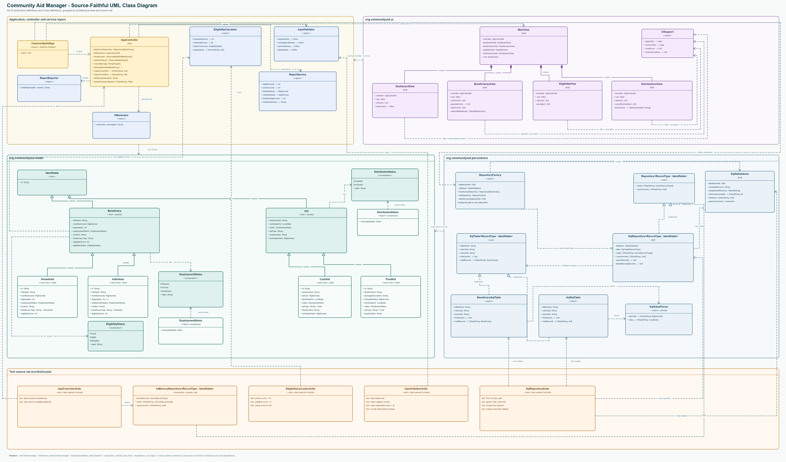

# Community Aid Eligibility & Distribution Manager

A ScalaFX 21 desktop application supporting UN Sustainable Development Goal 1: No Poverty. It helps a small NGO register applicants, calculate transparent eligibility scores, record cash or food assistance, and report distribution outcomes.

Built individually by **Isaac Chee Man Tou** for the Object-Oriented Programming module (PRG2104) at Sunway University, Jun – Aug 2026.

**Stack:** Scala 3 · ScalaFX 21 · SQLite (JDBC) · MUnit · sbt



## Highlights

- 20 Scala 3 classes, traits and enums across model, service, persistence, controller and UI layers
- Sealed `Beneficiary` trait with polymorphic `Household` and `Individual` subtypes
- Generic `Repository[RecordType]` / `SqlRepository[RecordType]` persistence layer over SQLite with prepared statements and transactional saves
- 13 of 13 MUnit tests passing; `sbt clean compile` with `-Wunused:all` finishes with zero warnings

## Features

1. **Beneficiary management**: add, edit, delete and review records in a table, and persist household or individual applicants.
2. **Eligibility calculation**: calculate a 0–100 score from income, dependants, employment status and applicant type, with a full points breakdown.
3. **Aid distribution tracking**: record cash or food aid only for eligible applicants, prevent same-day duplicates, and filter history by aid type.
4. **Dashboard and reporting**: display applicant and aid metrics, show recent distributions, and export a text summary to `reports/aid-summary.txt`.

## Requirements

- Java Development Kit 21
- sbt 1.9 or newer (the project declares sbt 1.10.7)
- Internet access on the first build so sbt can download ScalaFX, SQLite JDBC, SLF4J and MUnit

The build uses Scala 3.3.6, ScalaFX 21.0.0-R32, SQLite JDBC 3.53.2.0, SLF4J NOP 2.0.17 and MUnit 1.0.2.

## Setup and run

From the project root (the directory containing `build.sbt`):

```text
java -version
sbt clean compile
sbt test
sbt run
```

The Java version should begin with `21`. On first launch, `schema.sql` creates the SQLite tables and `sample-data.sql` inserts three sample applicants and two distributions.

## Eligibility policy

The policy is deliberately transparent rather than predictive:

- Monthly income at or below RM1,000: 55 points
- RM1,000.01–RM2,000: 40 points
- RM2,000.01–RM3,000: 25 points
- RM3,000.01–RM4,000: 10 points
- Above RM4,000: 0 points
- Each household dependant: 6 points, capped at 30
- Unemployed: 20 points; part-time: 10; employed: 0
- Household support adjustment: 5 points
- Final score is capped at 100

Scores of 70–100 are **Priority**, 45–69 are **Eligible**, and 0–44 are **Not eligible**. The policy is educational and is not intended to replace a real NGO or government assessment.

## OOP design

- `Beneficiary` is a sealed trait implemented by `Household` and `Individual`; both override `eligibilityScore` (subtype polymorphism).
- `Aid` is implemented by `CashAid` and `FoodAid`.
- `Repository[RecordType]`, `SqlRepository[RecordType]` and `SqlTable[RecordType]` demonstrate parametric polymorphism.
- `EligibilityCalculator`, `InputValidator`, `IdGenerator`, `ReportService` and `ReportExporter` extract shared logic and keep the UI DRY.
- Domain records are immutable case classes using `val` fields and immutable collections.
- Database operations return `Either` or are protected by `Try`; the UI shows friendly error messages instead of stack traces.

## ScalaFX implementation

Four panes (Dashboard, Beneficiaries, Eligibility and Distributions) sit inside one `JFXApp3` window with sidebar navigation. Controls include `TextField`, `Button`, `ComboBox`, `DatePicker`, `TableView`, `ListView`, `Label` and `ProgressBar`. Layout uses `BorderPane`, `VBox`, `HBox` and `GridPane`, with no primary absolute positioning. Reactive types include `ObservableBuffer` and `StringProperty`. Primary form buttons are default buttons, so Enter submits the focused form and Tab traversal provides keyboard access.

## Persistence

- When run with `sbt run`, records are stored in `data/community-aid.db`.
- `schema.sql` defines the tables, checks, indexes, foreign key and same-day aid uniqueness constraint.
- `SqlRepository[RecordType]` uses prepared statements and transactional batch saves; `SqlTable[RecordType]` supplies type-specific binding and decoding.
- Saving commits before the observable UI collection is updated, avoiding a false success state when a database operation fails.

## Tests

The MUnit suites cover:

- eligibility thresholds and the 100-point cap;
- blank, negative and out-of-range input, plus successful numeric parsing;
- SQLite creation with bundled sample records;
- generic SQL round-tripping with commas and quotation marks;
- database foreign-key and uniqueness enforcement;
- controller persistence; and
- rejection of aid for an ineligible applicant.

Run them with `sbt test`.

## AI use

AI assistance (OpenAI Codex) was used under the module's declared AI-use policy for planning, design review, edge-case analysis and debugging. Every interaction is recorded in [`ai/interaction_log.md`](ai/interaction_log.md), and AI-assisted source sections are tagged with `// ai-assisted: #N`.

## Licences

No external code or graphical assets were copied into the application. Build dependencies and their licences are listed in [`docs/citations.md`](docs/citations.md): ScalaFX (BSD 3-Clause), OpenJFX (GPLv2 with Classpath Exception), Scala (Apache 2.0), MUnit (Apache 2.0), SQLite JDBC (Apache 2.0) and SLF4J (MIT).
